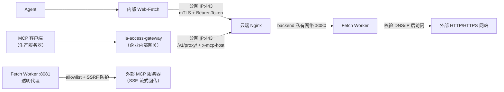

# Web Fetch Proxy

为不能直接访问互联网的内部 Web-Fetch 提供一个经过 mTLS 保护的云端出口；
同时提供 MCP（streamable-http）透明代理模式，让生产服务器经内部网关安全访问外部 MCP 服务器。



不需要域名。服务端证书使用云服务器公网 IPv4 的 IP SAN。

完整的网络拓扑、认证边界和请求时序见[完整架构图](docs/architecture.md#2-完整架构图)。

## 云端到底启动什么

唯一编排入口是根目录的 `compose.yaml`，其中明确包含两个服务：

| Compose 服务 | 职责 | 宿主机端口 |
|---|---|---|
| `nginx` | TCP 443、mTLS、来源 CIDR、限流和日志 | `443` |
| `fetch-worker` | URL 校验、SSRF 防护和外部 HTTP(S) 请求 | 不发布，仅供 Nginx 访问 |

推荐通过统一控制脚本启动。它显式执行：

```bash
docker compose up -d --wait fetch-worker nginx
```

因此 `start` 会同时启动 Fetch Worker 和 Nginx，而不是只启动 Worker。

## 新云服务器快速部署

假设：

- 云服务器公网 IP：`203.0.113.20`
- 内部服务器固定出口 IP：`198.51.100.10`

```bash
# 1. 生成配置、私有 CA、mTLS 双端证书和 Bearer Token；不会启动容器
./scripts/cloudctl.sh init 203.0.113.20 198.51.100.10/32

# 2. 预检并明确启动 fetch-worker + nginx
./scripts/cloudctl.sh start

# 3. 查看两个服务的状态
./scripts/cloudctl.sh status

# 4. 导出给内部服务器的最小客户端文件包
./scripts/cloudctl.sh export-client /tmp/web-fetch-client
```

完整步骤见 [部署手册](docs/deployment.md)。不要直接把示例 IP 用于真实环境。

云主机无法访问 Docker Hub 时，先按部署手册的“准备容器镜像”章节离线导入 `linux/amd64` 镜像，再执行 `start`。

## 本地开发验证

```bash
cp .env.example .env
./scripts/generate-mtls.sh init 127.0.0.1
./scripts/cloudctl.sh start
./scripts/cloudctl.sh verify
python3 examples/internal-web-fetch/internal_web_fetch.py fetch https://www.baidu.com/
```

本地示例发布 `127.0.0.1:8443`，仅用于开发；生产必须通过 `cloudctl.sh init <公网IP> <内部出口CIDR>` 初始化。

## 日常命令

```bash
./scripts/cloudctl.sh preflight
./scripts/cloudctl.sh start
./scripts/cloudctl.sh status
./scripts/cloudctl.sh logs nginx
./scripts/cloudctl.sh logs fetch-worker
sudo ./scripts/cleanup-logs.sh 7
./scripts/cloudctl.sh restart
./scripts/cloudctl.sh rebuild
./scripts/cloudctl.sh verify   # 仅本地或允许公网 IP 回环时；生产从内部客户端包执行 smoke-test.sh
./scripts/cloudctl.sh stop
```

## 项目结构

```text
.
├── compose.yaml                         云端唯一 Compose 入口，定义 Nginx 和 Worker
├── .env.example                         所有配置项及默认值
├── services/
│   └── fetch-worker/                    Go Fetch Worker、Dockerfile 和测试
├── deploy/
│   └── nginx/templates/                 Nginx mTLS 网关模板
├── examples/
│   ├── internal-web-fetch/              Python 内部 Web-Fetch 示例
│   └── ia-access-gateway/               网关模拟器与 MCP 端到端测试
├── scripts/
│   ├── cloudctl.sh                      初始化、启停、状态、日志、验收、客户端导出
│   ├── generate-mtls.sh                 PKI 和 Token 的初始化/独立轮换
│   ├── cleanup-logs.sh                   宿主机日志轮转、压缩与 7 天清理
│   └── smoke-test.sh                    mTLS、Token、SSRF、外网端到端验收
├── docs/
│   ├── architecture.md                  架构、接口与安全边界
│   ├── deployment.md                    新服务器从零部署
│   ├── operations.md                    日常运维、升级、备份与轮换
│   └── troubleshooting.md               故障码与排查方法
└── var/                                 运行时 PKI 和 Secret（生成内容不入 Git）
```

## 文档

- [架构与接口](docs/architecture.md)
- [部署手册](docs/deployment.md)
- [运维手册](docs/operations.md)
- [故障排查](docs/troubleshooting.md)
