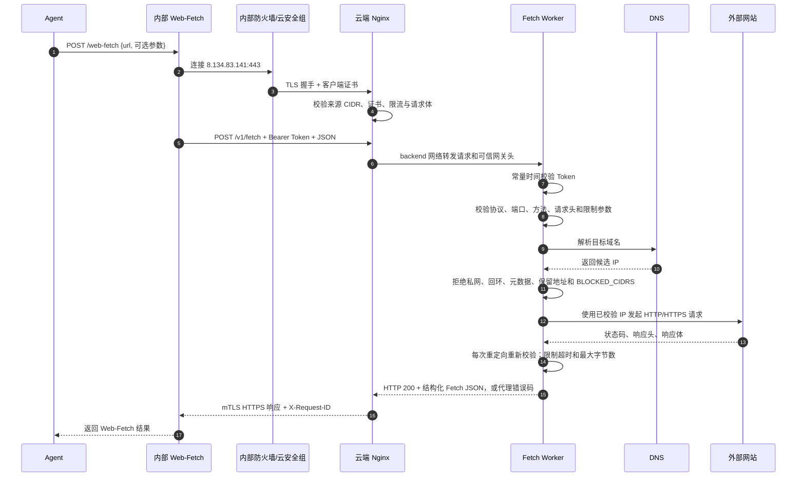
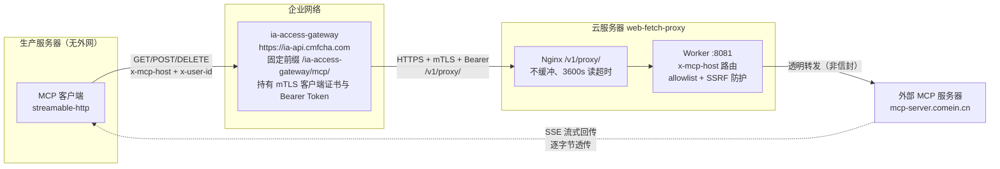

# Web Fetch 云端出口技术方案

## 1. 目标

内部服务器只需开通到一台云服务器的 HTTPS 网络。Agent 向内部 Web-Fetch 提交外部 URL，内部服务通过 mTLS 调用云端，云端 Fetch Worker 发起实际互联网请求并返回结构化结果。

Nginx 不解析请求中的 URL，也不直接动态代理外部地址。它只把经过来源 CIDR 和 mTLS 验证的请求，通过 Docker `backend` 私有网络转发给 Worker。Nginx 连接 `edge + backend` 网络；Worker 连接 `backend + egress` 网络，8080 不发布到宿主机。

## 2. 完整架构图

### 2.1 部署与网络拓扑

```mermaid
flowchart LR
    subgraph INTERNAL["内部网络（禁止直接访问外部网站）"]
        AGENT["Agent"]
        INTERNAL_FETCH["内部 Web-Fetch<br/>POST /web-fetch"]
        CLIENT_FILES["客户端凭证<br/>ca.crt<br/>client.crt<br/>client.key<br/>fetch_auth_token"]
        AGENT -->|"JSON：url=外部链接"| INTERNAL_FETCH
        CLIENT_FILES -.->|"本地安全读取"| INTERNAL_FETCH
    end

    INTERNAL_FW["内部防火墙<br/>仅允许到云公网 IP:443"]
    INTERNET["公网传输"]
    CLOUD_SG["云安全组<br/>来源出口 IP/32 → TCP 443"]

    subgraph CLOUD["云服务器 8.134.83.141"]
        HOST_443["宿主机 TCP 443<br/>唯一公开业务端口"]

        subgraph DOCKER["Docker Compose: web-fetch-proxy"]
            EDGE_NET(("edge 网络"))
            NGINX["Nginx mTLS 网关<br/>IP 来源校验<br/>服务端证书<br/>客户端证书校验<br/>限流/并发/日志"]
            BACKEND_NET(("backend 私有网络<br/>internal: true"))
            WORKER["Go Fetch Worker :8080<br/>Bearer Token 校验<br/>参数和请求头白名单<br/>DNS/重定向 SSRF 防护<br/>超时/大小/并发限制"]
            EGRESS_NET(("egress 网络<br/>仅 Worker 出站"))

            EDGE_NET --- NGINX
            NGINX -->|"POST /v1/fetch<br/>Authorization 原样转发"| BACKEND_NET
            BACKEND_NET -->|"HTTP :8080，不发布宿主机"| WORKER
            WORKER --> EGRESS_NET
        end

        SERVER_PKI["服务端运行材料<br/>ca.crt / server.crt / server.key"]
        TOKEN_SECRET["Docker Secret<br/>fetch_auth_token"]
        SERVER_PKI -.->|"只读挂载"| NGINX
        TOKEN_SECRET -.->|"只读挂载，启动时读取"| WORKER
        HOST_443 --> EDGE_NET
    end

    TARGET["外部 HTTP/HTTPS 网站<br/>仅 TCP 80/443"]

    INTERNAL_FETCH -->|"HTTPS + mTLS<br/>Authorization: Bearer token<br/>JSON 请求"| INTERNAL_FW
    INTERNAL_FW --> INTERNET --> CLOUD_SG --> HOST_443
    EGRESS_NET -->|"按已校验 IP 建立连接"| TARGET
    TARGET -.->|"状态、响应头和受限正文"| EGRESS_NET
    EGRESS_NET -.-> WORKER
    WORKER -.->|"结构化 JSON"| BACKEND_NET
    BACKEND_NET -.-> NGINX
    NGINX -.->|"HTTPS 响应"| INTERNAL_FETCH
    INTERNAL_FETCH -.->|"Web-Fetch 结果"| AGENT
```



图中的来源限制是生产目标状态：云安全组和 `ALLOWED_CLIENT_CIDR` 都应使用内部服务器真实公网出口的 `/32`。`0.0.0.0/0` 只能用于短时排障；即使 mTLS 仍生效，也不应作为最终配置。

### 2.2 单次请求时序



### 2.3 认证与信任关系

| 控制点 | 校验内容 | 失败表现 | 是否随请求变化 |
|---|---|---|---|
| 内部防火墙 | 只允许云公网 IP 的 TCP 443 | 连接超时或拒绝 | 否 |
| 云安全组 | 来源公网出口 IP/32 | 报文无法到达宿主机 | 否 |
| Nginx 来源规则 | `ALLOWED_CLIENT_CIDR` | HTTP 403 | 否 |
| Nginx mTLS | 客户端证书由私有 CA 签发且在有效期内 | TLS/HTTP 400 | 每次 TLS 连接校验 |
| Worker Bearer Token | `Authorization: Bearer <token>` 与 Secret 完全一致 | HTTP 401 | Token 固定，直到主动轮换 |
| Worker 出站策略 | URL、端口、DNS IP、重定向和响应限制 | 400/403/502/504 | 每次请求及每次重定向校验 |

## 3. 各层参数

### 3.1 Agent 到内部 Web-Fetch

```http
POST /web-fetch
Content-Type: application/json

{"url":"https://example.com/article"}
```

内部服务可接受以下扩展参数；第一版只传 `url` 即可：

| 参数 | 必填 | 默认值 | 服务端上限或规则 |
|---|---:|---:|---|
| `url` | 是 | - | 仅 HTTP/HTTPS，不允许 URL userinfo |
| `method` | 否 | `GET` | 仅 `GET`、`HEAD` |
| `headers` | 否 | `{}` | 仅允许明确的请求头白名单 |
| `timeout_ms` | 否 | 30000 | 不超过 60000 |
| `max_bytes` | 否 | 10 MiB | 不超过 50 MiB |
| `follow_redirects` | 否 | true | 每一跳重新校验 |
| `max_redirects` | 否 | 5 | 不超过 10 |

### 3.2 内部 Web-Fetch 到云端 Nginx

```http
POST https://<云服务器公网IP>/v1/fetch
Content-Type: application/json
Authorization: Bearer <token>
X-Request-ID: <uuid>
```

TLS 参数：

| 参数 | 内容 |
|---|---|
| 服务端证书 | `var/pki/server.crt` |
| 服务端私钥 | `var/pki/server.key` |
| 客户端证书 | 内部服务器持有的 `client.crt` |
| 客户端私钥 | 内部服务器持有的 `client.key` |
| 信任 CA | 双方信任 `var/pki/ca.crt` |
| TLS 版本 | TLS 1.2、TLS 1.3 |

不需要域名。使用公网 IP 访问时，服务端证书的 Subject Alternative Name 必须包含 `IP:<云服务器公网IP>`。只在证书 CN 中填写 IP 不足以通过现代 TLS 客户端的主机身份校验。

请求体示例：

```json
{
  "url": "https://example.com/article",
  "method": "GET",
  "headers": {
    "Accept": "text/html",
    "Accept-Language": "zh-CN,zh;q=0.9"
  },
  "timeout_ms": 30000,
  "max_bytes": 10485760,
  "follow_redirects": true,
  "max_redirects": 5
}
```

### 3.3 Nginx 到 Fetch Worker

Nginx 原样转发 JSON 和 `Authorization`，并覆盖或补充可信网关头：

```http
POST http://fetch-worker:8080/v1/fetch
X-Request-ID: <客户端请求ID或Nginx生成ID>
X-Client-IP: <Nginx观察到的源IP>
X-Client-Cert-Subject: <客户端证书Subject>
```

网关限制：

| 参数 | 值 |
|---|---:|
| 请求体上限 | 64 KiB |
| 单来源速率 | 10 请求/秒 |
| 突发量 | 20 |
| 单来源并发连接 | 20 |
| Worker 连接超时 | 3 秒 |
| Worker 读取超时 | 70 秒 |

### 3.4 Fetch Worker 到外部网站

Worker 根据 JSON 构造标准 HTTP 请求。允许向外传递：`Accept`、`Accept-Language`、`User-Agent`、`Range`、`If-None-Match`、`If-Modified-Since`。

明确禁止转发 `Authorization`、`Proxy-Authorization`、`Cookie`、`Host`、`Forwarded`、`X-Forwarded-For` 等敏感或逐跳请求头。

Worker 会拒绝回环、私网、链路本地、CGNAT、多播、保留地址、云元数据地址和云服务器本机地址。每次 DNS 连接和重定向均重新执行 URL、端口和目标 IP 校验。

## 4. 返回格式

成功访问外部网站时，云端接口自身返回 HTTP 200，外部网站状态码放在 JSON 的 `status` 字段：

```json
{
  "request_id": "...",
  "requested_url": "https://example.com",
  "final_url": "https://example.com/",
  "status": 200,
  "headers": {"content-type": "text/html; charset=UTF-8"},
  "body": "<html>...</html>",
  "body_encoding": "utf8",
  "size": 1256,
  "truncated": false,
  "redirects": [],
  "elapsed_ms": 186
}
```

非 UTF-8 内容使用 Base64。达到响应上限时返回已经读取的前 `max_bytes` 字节，并设置 `truncated: true`。

代理自身错误使用以下状态：

| HTTP | 错误码 | 含义 |
|---:|---|---|
| 400 | `INVALID_REQUEST` / `INVALID_URL` | JSON 或 URL 不合法 |
| 401 | `UNAUTHORIZED` | Token 缺失或错误 |
| 403 | `DESTINATION_BLOCKED` | 目标地址被安全策略阻止 |
| 405 | `METHOD_NOT_ALLOWED` | 方法不允许 |
| 429 | `TOO_MANY_REQUESTS` | Worker 并发达到上限 |
| 502 | `DNS_FAILED` / `CONNECT_FAILED` / `TLS_FAILED` | 外部网络失败 |
| 504 | `FETCH_TIMEOUT` | 外部请求超时 |

## 5. 安全边界

1. 云安全组只允许内部服务器固定出口 IP 访问 TCP 443。
2. Nginx 的 `ALLOWED_CLIENT_CIDR` 再次限制来源 IP。
3. Nginx 强制校验客户端证书；没有合法客户端私钥无法通过请求认证。
4. Bearer Token 是独立的第二层鉴权，存放在 Docker secret 中。
5. Worker 不发布宿主机端口，只能被 Nginx 通过 `backend` 私有网络访问。
6. Worker 对 DNS 解析结果和真正建立的连接使用同一批经过验证的 IP，降低 DNS 重绑定风险。
7. `BLOCKED_CIDRS` 必须加入云服务器自身公网 IP，避免 Worker 回连云服务器公开服务。
8. 生产环境应定期轮换服务端证书、客户端证书和 Token，并监控到期时间。
9. URL 查询串可能含敏感信息，默认访问日志只由 Nginx 记录 API 路径；Worker 日志不输出请求正文。

## 6. 代码与部署组件映射

| 层 | 路径 | 启动方式 |
|---|---|---|
| Nginx mTLS 网关 | `deploy/nginx/templates/default.conf.template` | Compose 服务 `nginx` |
| Go Fetch Worker | `services/fetch-worker/` | Compose 服务 `fetch-worker` |
| 云端统一控制 | `scripts/cloudctl.sh` | `cloudctl.sh start` 明确启动上述两个服务 |
| 宿主机日志 | `var/log/nginx/`、`var/log/fetch-worker/` | Compose 绑定挂载，systemd 每日轮转并保留 7 天 |
| 内部测试实现 | `examples/internal-web-fetch/internal_web_fetch.py` | Python 标准库直接运行 |
| 网关模拟器与 MCP 端到端测试 | `examples/ia-access-gateway/` | Python 标准库直接运行 |
| 运行时身份 | `var/pki/`、`var/secrets/` | `cloudctl.sh init` 生成，不入 Git |

## 7. MCP 透明代理模式

### 7.1 目标与链路

企业内部生产服务器需要访问外部 MCP 服务器（如 `https://mcp-server.comein.cn/mcp-servers/institutioncenter`），
但所有外部流量必须经内部网关（`https://ia-api.cmfcha.com`，固定前缀 `/ia-access-gateway/mcp/`）收敛到云端，
使防火墙只需开通"网关 → 云服务器"一条规则：



`/v1/fetch`（JSON 信封模式）保持零改动。代理模式是独立的第二个监听端口 `:8081`，
因为现有 8080 server 的 `WriteTimeout=MaxTimeout+10s` 会掐死 SSE 长连接；代理 server
不设写超时，空闲流由 Nginx `proxy_read_timeout 3600s` 掐断。

### 7.2 x-mcp-host 路由约定

- 客户端在请求头 **`x-mcp-host`** 中指定真正代理的外部 MCP 服务器 origin
  （如 `https://mcp-server.comein.cn`；裸域名默认 https）
- 公共路径前缀之后的部分原样映射：`<网关>/ia-access-gateway/mcp/<path>` → `<上游>/<path>`
- Worker 消费该头后剥离，**绝不转发给上游**
- 上游必须命中云端 allowlist（`ALLOWED_UPSTREAM_HOSTS`，逗号分隔；条目为裸域名
  `mcp-server.comein.cn` 或 `host:port`）。裸域名条目只放行 80/443 端口；
  allowlist 为空 = 代理功能整体关闭（fail-closed）

### 7.3 头部策略

| 请求头 | 处理 |
|---|---|
| `Authorization`（客户端发出） | 上游凭证，由**网关改名为 `X-Upstream-Authorization`** 后交给云端；客户端配置与直连供应商时完全一致 |
| `Authorization`（云端收到） | 网关注入的云端 Bearer Token，Worker 校验后剥离、绝不转发上游 |
| `X-Upstream-Authorization` | Worker 映射为转发上游时的 `Authorization`（客户端显式提供时优先于改名） |
| 其余一切请求头 | **原样透传**（含 `x-user-id`、`Mcp-Session-Id`、`MCP-Protocol-Version`、`Last-Event-ID`、`Accept`、`Content-Type`、`User-Agent` 及供应商自定义头如 `X-Api-Key`） |
| `X-Request-ID`、`X-Client-IP`、`X-Client-Cert-Subject`、`X-Forwarded-For` | 到达 Worker 后剥离 |

响应方向：上游状态码、全部响应头（除逐跳头）与正文逐字节透传（非信封），
Worker 的代理 Transport 已关闭自动 gzip——客户端没发 `Accept-Encoding` 时不会
代为注入，上游压缩的响应也原样回传、不做透明解压。
`FlushInterval: -1` 保证 SSE 每写即刷。上游 3xx 的 `Location` 在配置
`PUBLIC_PATH_PREFIX`（如 `/ia-access-gateway/mcp`）时改写为带前缀路径，
解决 FastAPI 系尾斜杠 307 重定向丢前缀问题；跨主机重定向原样透传并告警。

### 7.4 内部网关（ia-access-gateway）配置清单

网关团队按下表配置，任何一项缺失都会破坏 streamable-http 传输：

| # | 项目 | 要求 |
|---:|---|---|
| 1 | 前缀改写 | `/ia-access-gateway/mcp/<path>` → 云端 `/v1/proxy/<path>` |
| 2 | 方法白名单 | 允许 GET、POST、DELETE |
| 3 | 流式透传 | 响应逐块转发、关闭响应缓冲（SSE 必需） |
| 4 | 读超时 | 长连接读超时 ≥ 3600s（不能沿用普通 API 的几十秒） |
| 5 | 头部透传 | **默认透传所有请求头**（含供应商自定义头如 `X-Api-Key`），仅排除逐跳头、`Host`（改为云端地址）与 `Authorization`（按第 8 项改写）。禁止实现白名单式头部过滤，否则供应商私有头会被丢弃 |
| 6 | 不压缩 | 关闭 gzip/brotli（压缩会攒缓冲破坏流式） |
| 7 | 不缓存、不重试、不拦截错误页 | 3xx/4xx/5xx 原样透传，失败不自动重发 POST |
| 8 | 凭证改写与注入 | 客户端 `Authorization` 改名为 `X-Upstream-Authorization`（供应商配置原样可用），再注入云端 Bearer Token 与 mTLS 客户端证书；生产服务器不落云端凭证 |
| 9 | 限流口径 | 客户端是网关单 IP，云端的代理限流（100r/s、并发 200）已按聚合流量放宽，网关侧自行按用户维度限流 |

### 7.5 安全边界（代理模式增量）

在 `/v1/fetch` 已有边界之上：

1. 上游 allowlist fail-closed：未配置 `ALLOWED_UPSTREAM_HOSTS` 时代理路由整体 403。
2. `x-mcp-host` 仅接受 http/https origin，禁止 userinfo、路径、查询与 scheme 之外的一切内容。
3. 出站连接复用 safeDialer：DNS 解析 → IP 校验（私网/回环/元数据/保留段拒绝）→ 用已验证 IP 建连，防 DNS 重绑定。
4. 代理请求体上限 64 KiB；响应流总量上限 `PROXY_MAX_STREAM_BYTES`（默认 100 MiB，超限断流并告警）。
5. 代理并发独立信号量 `PROXY_MAX_CONCURRENCY`（默认 50），占满返回 429，不影响 `/v1/fetch`。

### 7.6 错误码（代理模式）

| HTTP | 错误码 | 含义 |
|---:|---|---|
| 400 | `INVALID_REQUEST` | 缺 `x-mcp-host`、头值不合法或请求体超限 |
| 401 | `UNAUTHORIZED` | 云端 Bearer Token 缺失或错误 |
| 403 | `UPSTREAM_NOT_ALLOWED` | 上游不在 `ALLOWED_UPSTREAM_HOSTS`（含 allowlist 为空） |
| 403 | `DESTINATION_BLOCKED` | 上游地址被 SSRF 策略阻止 |
| 405 | `METHOD_NOT_ALLOWED` | 非 GET/POST/DELETE |
| 429 | `TOO_MANY_REQUESTS` | 代理并发达到上限 |
| 502/504 | `DNS_FAILED` / `CONNECT_FAILED` / `TLS_FAILED` / `FETCH_TIMEOUT` | 上游网络失败 |

### 7.7 MCP 客户端配置

生产服务器上（经真实网关）：

```json
{
  "institutioncenter": {
    "url": "https://ia-api.cmfcha.com/ia-access-gateway/mcp/mcp-servers/institutioncenter",
    "type": "streamable-http",
    "headers": {
      "x-mcp-host": "https://mcp-server.comein.cn",
      "x-user-id": "<comein 业务用户ID>"
    }
  }
}
```

本地联调见 `examples/ia-access-gateway/README.md`（网关模拟器 + 端到端测试脚本）。

### 7.8 启用流程

1. 云端 `.env` 设置 `ALLOWED_UPSTREAM_HOSTS=mcp-server.comein.cn`（按需追加 `host:port` 条目）
2. 网关使用公共前缀时同步设置 `PUBLIC_PATH_PREFIX=/ia-access-gateway/mcp`
3. `./scripts/cloudctl.sh restart`
4. `./scripts/cloudctl.sh verify` 跑通含 MCP 代理的 8 步验收
5. 网关团队按 7.4 清单配置后，用 `examples/ia-access-gateway/mcp_client_test.py`
   （改 `GATEWAY_HOST`/`GATEWAY_PORT` 指向真实网关）做生产联调
